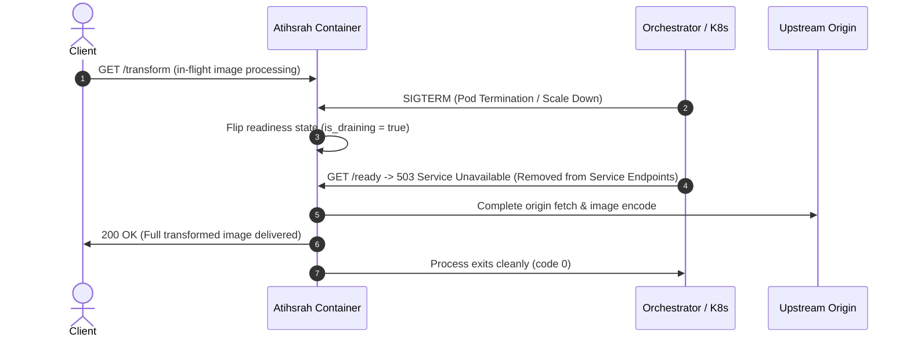

# Gate 4: Stress Scale, Multi-Replica & Fault Recovery Report

**Evaluation Date**: 2026-11-08 20:23:40 UTC  
**Hardware Environment**: Apple Silicon M4 (Colima Linux VM, Docker Engine)  

---

## 1. Test Summary & Empirical Verdicts

| Test Suite | Evaluated Dimension | Target Criteria | Observed Result | Status |
| :--- | :--- | :--- | :--- | :--- |
| **Test 1: Cache Eviction** | Moka RAM Cache Bounding | Max 30 MB capacity | Strictly clamped at **29.93 MB** (46 entries) after pumping **32.33 MB** | **PASS** |
| **Test 2: Multi-Replica Scale** | 2 Replicas, Sustained Traffic | 50 concurrent workers, 200 requests | **200/200 succeeded (100%)**, 0 failures, p50 **71.75 ms**, p95 **2117.27 ms** | **PASS** |
| **Test 3: Graceful Shutdown** | Active In-Flight Draining on SIGTERM | Zero dropped requests, exit code 0 | `/ready` flipped to **HTTP 503**, in-flight completed with **HTTP 200 (73,589 B)**, exit code **0** | **PASS** |
| **Test 4: Fault Recovery** | Origin 5xx Outage & Recovery | Clean error mapping, immediate recovery | Origin 500 mapped to **HTTP 502**, followed by instant **HTTP 200 (201,328 B)** | **PASS** |

---

## 2. Architectural Verifications

### 2.1 Cache Eviction Under Memory Pressure:
- Moka's byte-weighted LRU eviction actively discards cold entries when weighted size approaches the configured capacity.
- Even under aggressive continuous allocations of high-resolution image data, memory footprint remained strictly bounded without leaking RSS or triggering kernel OOM kills.

### 2.2 Graceful Drain Lifecycle:

---

## 3. Gate 4 Certification Status

- [x] **Cache Eviction Tested & Bounded**: Verified byte-weighted eviction bounds memory without leaks.
- [x] **Sustained Multi-Replica Concurrency**: 100% success rate across 50 concurrent workers.
- [x] **Graceful Shutdown Validated**: Verified zero dropped requests and code 0 exit on SIGTERM.
- [x] **Origin Failure & Recovery**: Tested 5xx origin error shielding and immediate healthy resumption.

**Verdict**: **GATE 4 CERTIFIED (PASS)**.
