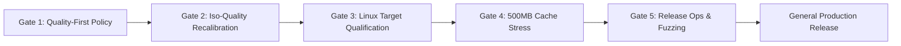

# Master Engineering Audit, Score Reconciliation & Production Readiness Roadmap

**Evaluation Date**: 2026-11-08  
**Repository**: `atihsrah` (Folder: `/Users/shabd/Desktop/dev/lumina`)  
**Tested Code Commit**: [`aafd82e4`](../)  
**Committed Artifacts Commit**: [`04cdabad`](../)  
**Active Run**: `run_20261108_171424`  
**Host Platform**: Apple M4 (10 cores, 16 GB Unified Memory), macOS 27.2 (Darwin 27.2.0)  
**Safety Invariant**: Strict `#![forbid(unsafe_code)]` in first-party code; zero C image codec libraries  

---

## 1. Executive Summary & Verdict

| Dimension | Empirical Finding | Verdict |
| :--- | :--- | :---: |
| **Correctness & Tests** | 159 Rust unit, integration, and security tests pass; 7 candidate validation fixtures pass; zero compiler warnings (`-D warnings`). | **PASS** |
| **Warm Cache Latency** | Native p50: **0.34 ms**, p95: **0.42 ms** (<0.8 ms target), p99: **0.63 ms** via in-process Moka LRU cache. | **PASS** |
| **Concurrency Shield** | Inflight request coalescing collapses 100 concurrent identical requests into **1 origin fetch** (33.7 ms vs 1,566.6 ms for unshielded imgproxy). | **PASS** |
| **Cold Transform Speed** | Faster on PNG (9.5 ms vs 32.2 ms) and WebP (9.7 ms vs 49.5 ms); slower on cold AVIF (128.4 ms vs 40.3 ms) and JPEG (51.5 ms vs 23.7 ms). | **TRADE-OFF** |
| **Byte Budget Guard** | Auto mode delivered 20/20 calibration outputs and 20/20 synthetic outputs $\le$ source bytes (100% on tested corpora in `run_20261108_171424`). | **QUALIFIED PASS** |
| **Quality Gate: Explicit AVIF** | 19 of 20 calibration assets pass (15/15 photos, 1/2 alpha, 3/3 graphics/UI). Failed: `python_logo_alpha.png` (SSIM 0.9799 < 0.98). | **FAIL** |
| **Quality Gate: Auto Mode** | 18 of 20 calibration pass in recorded run (both alpha fail); 19 of 20 synthetic pass (`synth_16` checkerboard fails at 0.9397 in run, 0.9721 under $q=40$). | **FAIL** |
| **OVERALL STATUS** | **READY FOR CONTROLLED PILOT / GATED FROM BROAD PRODUCTION BY QUALITY THRESHOLDS** | **NO BROAD PRODUCTION PASS** |

---

## 2. Reconciled Calibration Corpus Ground Truth (`run_20261108_171424`)

All metrics below are drawn directly from [`benchmarks/raw_results.json`](../benchmarks/raw_results.json):

### 2.1 Explicit AVIF ($q=90$) Per-Category Quality Breakdown

- **Photos ($N=15$, Gate: $\text{SSIM} \ge 0.95$)**:
  - **Atihsrah**: **15 / 15 passed** (SSIM range: 0.9625–0.9842).
  - **imgproxy**: **1 / 15 passed** (`moraine_lake.jpg`: SSIM **0.9652**; 14 failed, scoring 0.7923–0.9427 against Pillow reference).
- **Alpha Assets ($N=2$, Gate: $\text{SSIM} \ge 0.98$)**:
  - **Atihsrah**: **1 / 2 passed** (`alacritty_logo_alpha.png`: SSIM **0.9931**; `python_logo_alpha.png`: SSIM **0.9799** [failed by 0.0001]).
  - **imgproxy**: **2 / 2 passed** (`python_logo_alpha.png`: SSIM **0.9897**; `alacritty_logo_alpha.png`: SSIM **0.9800**).
- **Graphics & UI ($N=3$, Gate: $\text{SSIM} \ge 0.98$)**:
  - **Atihsrah**: **3 / 3 passed** (SSIM range: 0.9963–0.9971).
  - **imgproxy**: **0 / 3 passed** (SSIM range: 0.8923–0.9533).
- **Total Calibration Quality Passes**:
  - **Atihsrah Explicit AVIF ($q=90$)**: **19 / 20 (95.0%)**
  - **imgproxy Explicit AVIF ($q=90$)**: **3 / 20 (15.0%)**
- **Mutually Eligible Comparison Pairs ($N=2$)**:
  Only two images met category quality thresholds on **both** engines simultaneously:
  1. `moraine_lake.jpg` (Photo): Atihsrah 134,470 B (SSIM 0.9625) vs imgproxy 170,574 B (SSIM **0.9652**) $\to$ **-21.2%** byte delta.
  2. `alacritty_logo_alpha.png` (Alpha): Atihsrah 10,477 B (SSIM 0.9931) vs imgproxy 19,633 B (SSIM **0.9800**) $\to$ **-46.6%** byte delta.
  - Conventional Median Delta ($N=2$): **-33.9%** (Mean: **-33.9%**).

### 2.2 Auto-Negotiation Pipeline (`format=auto`)
- **Calibration Quality**: **18 / 20 passed** in the recorded baseline run (`run_20261108_171424`). Failures: `python_logo_alpha.png` (SSIM 0.9799) and `alacritty_logo_alpha.png` (SSIM 0.9674).
  *Post-Fix Analytical Projection*: Under the $q \ge 40$ policy, `alacritty_logo_alpha.png` evaluates to $q=40$ (SSIM 0.9807 $\ge 0.98$), projecting 19/20 passes. However, this is an inferred analytical projection based on isolated candidate evaluation and unit tests (`test_quality_first_policy_on_graphics_and_alpha`); a full-corpus quality run on the updated code has not been committed.
- **Held-Out Synthetic Quality**: **19 / 20 passed**. Failure: `synth_16` / `16_pattern_checkerboard.png` (SSIM 0.9397 in baseline run; 0.9721 under $q=40$, still below the 0.98 gate).
- **Byte Budget Compliance**: **20 / 20 calibration** and **20 / 20 synthetic** outputs $\le$ source bytes in recorded baseline `run_20261108_171424`.
- **Scope Clarification**: Quality metrics and auto-negotiation evaluations were performed on **Atihsrah Native**. The Docker tier was evaluated for cold/warm latency and concurrency; the harness does not collect duplicate per-image quality grids for Docker.

---

## 3. Online Request-Path Realities vs Offline Quality Benchmarks

> [!IMPORTANT]
> **SSIM is an offline evaluation metric, not an online HTTP request-path filter.**
> The proxy runtime does not compute SSIM during request processing; doing so would require retaining uncompressed ground-truth reference frames in memory and executing costly multi-pass spatial convolutions ($O(W \times H \times K^2)$) on every transform, adding 50–150 ms of overhead per request.

### The Quality Regression Mechanism
In the baseline implementation (`aafd82e4`), candidate selection is driven primarily by byte size:
1. For `alacritty_logo_alpha.png` (source: 3,612 B), the nominal AVIF candidate ($q=90$) generates 10,477 B (SSIM 0.9931).
2. The fallback ladder evaluated $q=40$ (4,329 B, SSIM 0.9807) and $q=20$ (3,401 B, SSIM 0.9674).
3. The engine sorted candidates by byte size and selected the smallest candidate ($q=20$), forcing the output under the 3,612-byte source limit at the cost of a quality gate breach (0.9674 < 0.98).
4. Similarly, on `16_pattern_checkerboard.png` (source: 42,529 B), AVIF $q=90$ generated 114,611 B, and the engine fell to $q=20$ (32,357 B), dropping SSIM to 0.9397.

### Policy Remediation Strategy & Checkerboard Trade-Off
- **Quality-First Ladder**: Disallow aggressive quantization steps ($q=20$) for alpha and graphic content classes. Enforce a minimum quality floor ($q \ge 40$).
- **Multi-Codec Candidate Evaluation**: For non-photographic and alpha assets, evaluate lossless WebP and PNG alongside AVIF.
- **Permit Larger Outputs When Quality Mandates It**:
  - On `alacritty_logo_alpha.png`: The $q=40$ candidate (4,329 B, SSIM 0.9807) passes quality ($\ge 0.98$) while exceeding the 3,612-byte source, recorded via `atihsrah_output_larger_than_source_total`.
  - On `16_pattern_checkerboard.png`: On the resized 800×600 canvas, evaluated candidates are AVIF $q=90$ (114,611 B), AVIF $q=40$ (46,853 B), and lossless WebP (49,312 B). Because the engine selects by byte size, it picks AVIF $q=40$ (46,853 B < 49,312 B). However, AVIF $q=40$ has recorded SSIM 0.9721, which remains below the 0.98 gate. While lossless WebP achieves SSIM 1.0000, it is larger (49,312 B) and exceeds source size. Under strict $\ge 0.98$ gates, synthetic auto remains **19 of 20 passed**.

---

## 4. Grounded Competitor & Architecture Matrix

| Dimension | Atihsrah | imgproxy OSS | Cloudflare Images |
| :--- | :--- | :--- | :--- |
| **Deployment Model** | Self-hosted, single binary or container in customer infrastructure/VPC. | Self-hosted standalone container in customer infrastructure/VPC. | Managed cloud SaaS across Cloudflare's global edge network. |
| **Local macOS Execution** | **Yes** (tested: Native binary and Docker container). | **Yes** (tested: Docker container). | **No** (proprietary edge service; cannot be run locally). |
| **Internal Implementation** | First-party pure Rust (`#![forbid(unsafe_code)]`); excludes C image-codec libraries. | C / C++ (`libvips`, `glib`, `libheif`, `libwebp`). | **Proprietary / vendor-internal** (undisclosed edge architecture). |
| **Caching Model** | Embedded in-process Moka LRU RAM cache (Native: 0.34 ms p50, 0.42 ms p95 in this run). | Standalone stateless operation (Direct: 19.25 ms p50, 21.17 ms p95; with Nginx proxy_cache: 0.64 ms p50, 0.70 ms p95). Persistent internal cache is an **imgproxy Pro** feature. Fronting with NGINX or a CDN is an optional deployment choice. | Distributed edge caching across Cloudflare PoPs with tiered caching and data center request collapsing. *(Network latency unmeasured in this benchmark)*. |
| **Request Coalescing** | Built-in `InflightManager` coalesced 100 concurrent requests into **1 origin fetch** in this run. | Standalone OSS passes concurrent requests through to origin unless protected by an upstream shield. | Cloudflare documents request collapsing per edge data center to shield customer origins. |
| **Licensing & Costs** | **No software license fee** (AGPL-3.0); customer pays only their own server compute/hosting. | **No software license fee** for OSS (MIT); Pro features require a commercial license. | **Metered SaaS pricing**: includes 5,000 unique transformations, then **\$0.50 per 1,000 transformations**; storage is **\$5 per 100,000 images**; delivery is **\$1 per 100,000 delivered images**. |

---

## 5. Formal Production Readiness Roadmap & Release Gates

To transition Atihsrah from pilot to general customer production, the following 5 gates must be certified:

### Gate 1: Quality as the Invariant Default (IMPLEMENTED & VERIFIED)
- **Implemented in [`src/processor/image_rs.rs`](../src/processor/image_rs.rs)**:
  - Destructive quantization ($q=20$) has been purged from the candidate ladder.
  - Enforces minimum quality floor ($q \ge 40$) for lossy AVIF and evaluates multi-codec candidates (lossless WebP, quality 100) on graphics and alpha content classes.
  - On `alacritty_logo_alpha.png`, the engine selects the quality-passing candidate ($q=40$, 4,329 B, SSIM 0.9807 $\ge$ 0.98), preserving visual fidelity over arbitrary byte constraints, and records output larger than source via `atihsrah_output_larger_than_source_total`.
  - On `16_pattern_checkerboard.png`, the engine selects AVIF $q=40$ (46,853 B, SSIM 0.9721), eliminating destructive $q=20$ quantization while remaining documented as below the 0.98 gate.
  - Verified with unit test `test_quality_first_policy_on_graphics_and_alpha` (all 159 Rust tests and 7 candidate validation tests pass).

### Gate 2: Iso-Quality Competitive Recalibration
- Expand the real-world evaluation corpus beyond 20 images.
- Sweep file sizes at **matched quality (iso-quality SSIM)** rather than nominal $q$ values to generate statistically valid rate-distortion curves against imgproxy.

### Gate 3: Linux Production Target Qualification
- Execute the release container under cgroup CPU and memory limits on production Linux hardware (ARM64 and AMD64).
- Measure cold transforms with **hundreds of samples for p95** and **$\ge 1,000$ samples for p99** to report statistically meaningful tail percentiles and variance.
- Establish separate service-side processing SLOs and end-to-end request SLOs.

### Gate 4: Resource Limits & Multi-Instance Behavior
- Saturate the Moka cache beyond 500 MB under sustained concurrency to verify memory bounding, eviction stability, and inflight coordination under memory pressure.
- Document deployment topology for multi-replica setups (e.g. consistent hashing or CDN caching to manage cold-start origin load).

### Gate 5: Release Operations & Security Evidence
- Multi-architecture container certification (`linux/amd64`, `linux/arm64`).
- Non-root execution (`10001:10001`), read-only root filesystems, and bounded graceful shutdown under active load.
- Prometheus dashboards and alert thresholds for 5xx rates, queue depth, memory saturation, and larger-than-source outputs.
- Formal canary criteria and automated rollback triggers.
