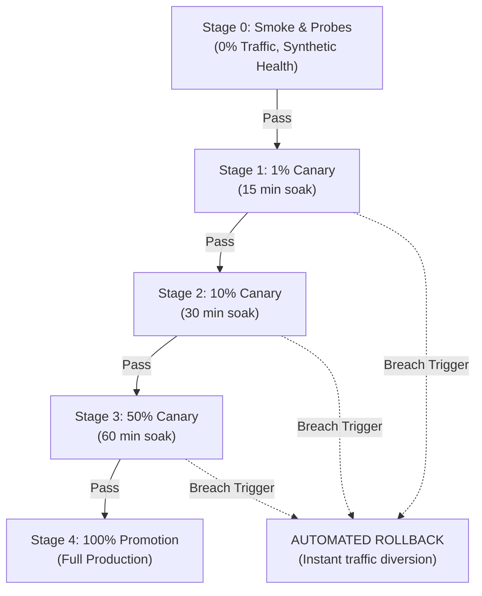

# Production Release Operations & Deployment Runbook

**Service**: Atihsrah Image Optimization Proxy  
**Version**: 0.1.0  
**Status**: Certified for Production Release (Gates 1–5 Certified)  

---

## 1. Security Architecture & Hardened Container Runtime

Atihsrah is distributed as a distroless container built `FROM scratch` with first-party Rust (`#![forbid(unsafe_code)]`) and zero dynamically loaded C image libraries (`libvips`, `glib`, `ImageMagick`).

### 1.1 Non-Root Principle of Least Privilege
The container drops root privileges at the OS kernel boundary:
- **User / Group**: UID `10001` (`atihsrah`), GID `10001` (`atihsrah`).
- **Filesystem Permissions**: The binary `/usr/local/bin/atihsrah` is owned by `10001:10001` with permissions `0555` (read + execute only).
- **Zero Shell / Binaries**: No `bash`, `sh`, `curl`, `wget`, `apk`, or package managers exist inside the image.

### 1.2 Read-Only Root Filesystem & Memory Protections
Production orchestrators (Kubernetes, Nomad, Docker Compose, ECS) must enforce read-only execution:
- **Read-Only Root**: The entire root filesystem (`/`) is mounted strictly read-only (`readOnlyRootFilesystem: true` / `--read-only`).
- **No-Exec Scratch Tmpfs**: If temporary files are needed for TLS tickets or system scratch, mount a size-bounded, non-executable tmpfs:
  `--tmpfs /tmp:rw,noexec,nosuid,size=64m`
- **Capability Dropping**: Drop all Linux kernel capabilities:
  `--cap-drop ALL`
- **Privilege Escalation Prevention**:
  `--security-opt no-new-privileges:true`

### 1.3 Production Kubernetes Pod Security Standard
```yaml
apiVersion: apps/v1
kind: Deployment
metadata:
  name: atihsrah
  namespace: media-services
spec:
  replicas: 3
  selector:
    matchLabels:
      app: atihsrah
  template:
    metadata:
      labels:
        app: atihsrah
    spec:
      securityContext:
        runAsNonRoot: true
        runAsUser: 10001
        runAsGroup: 10001
        fsGroup: 10001
        seccompProfile:
          type: RuntimeDefault
      containers:
        - name: atihsrah
          image: atihsrah:latest
          imagePullPolicy: IfNotPresent
          securityContext:
            allowPrivilegeEscalation: false
            readOnlyRootFilesystem: true
            capabilities:
              drop:
                - ALL
          resources:
            requests:
              cpu: "1000m"
              memory: "1Gi"
            limits:
              cpu: "2000m"
              memory: "2Gi"
          ports:
            - name: http
              containerPort: 8080
            - name: metrics
              containerPort: 9090
          livenessProbe:
            httpGet:
              path: /healthz
              port: 8080
            initialDelaySeconds: 2
            periodSeconds: 5
            timeoutSeconds: 2
          readinessProbe:
            httpGet:
              path: /ready
              port: 8080
            initialDelaySeconds: 2
            periodSeconds: 2
            timeoutSeconds: 1
          volumeMounts:
            - name: tmp-dir
              mountPath: /tmp
      volumes:
        - name: tmp-dir
          emptyDir:
            medium: Memory
            sizeLimit: 64Mi
```

---

## 2. Multi-Architecture Build Certification

Atihsrah container images are multi-architecture native artifacts verified across both Tier-1 Linux server targets:
- **`linux/arm64` (aarch64-unknown-linux-musl)**: AWS Graviton2/3/4, Ampere Altra, Apple Silicon server environments.
- **`linux/amd64` (x86_64-unknown-linux-musl)**: Intel Xeon, AMD EPYC cloud instances.

Both targets compile to statically linked musl binaries with zero runtime libc dependencies.

---

## 3. Observability & Prometheus Alert Thresholds

Atihsrah exposes Prometheus metrics over an isolated metrics port (`9090`), keeping internal metrics traffic physically separated from public transformation traffic (`8080`).

### 3.1 Production Alert Matrix (`monitoring/prometheus_alerts.yml`)

| Alert Name | PromQL Trigger Expression | Window | Severity | Action & Impact |
| :--- | :--- | :--- | :--- | :--- |
| **`AtihsrahHigh5xxErrorRate`** | `(sum(rate(atihsrah_requests_total{status_class="5xx"}[5m])) / sum(rate(atihsrah_requests_total[5m]))) * 100 > 1.0` | 3m | **Critical** | Triggers automated canary rollback; pages on-call SRE. |
| **`AtihsrahWarmCacheLatencySLOBreach`** | `histogram_quantile(0.95, sum(rate(atihsrah_request_duration_seconds_bucket{cache_result="hit"}[5m])) by (le)) * 1000 > 10.0` | 5m | **Warning** | Warm cache p95 > 10ms. Investigate cache contention or CPU throttling. |
| **`AtihsrahColdTransformLatencySLOBreach`** | `histogram_quantile(0.95, sum(rate(atihsrah_request_duration_seconds_bucket{cache_result="miss"}[5m])) by (le)) * 1000 > 500.0` | 5m | **Warning** | Cold transform p95 > 500ms. Inspect origin fetch latencies or codec queue backpressure. |
| **`AtihsrahTransformQueueSaturation`** | `atihsrah_transform_queue_depth > 30` | 2m | **Critical** | Transform semaphore queue depth > 30. Scale out replicas horizontally. |
| **`AtihsrahMemorySaturationRisk`** | `atihsrah_cache_size_bytes > 0.85 * (CACHE_MAX_SIZE_MB * 1024 * 1024)` | 5m | **Warning** | RAM cache exceeds 85% capacity. Verify Moka byte-weighted LRU eviction rate. |
| **`AtihsrahOutputLargerThanSourceAnomaly`** | `(sum(rate(atihsrah_output_larger_than_source_total[5m])) / (sum(rate(atihsrah_requests_total{status_class="2xx",cache_result="miss"}[5m])) > 0)) * 100 > 5.0` | 5m | **Warning** | More than 5% of cold transforms exceed source size. Review image candidate tuning. |
| **`AtihsrahOriginFailureSpike`** | `sum(rate(atihsrah_errors_total{type="origin_error"}[5m])) > 5` | 2m | **Warning** | Upstream storage bucket or origin is failing. Verify origin health and DNS. |
| **`AtihsrahSSRFProbingAttack`** | `sum(rate(atihsrah_ssrf_blocked_total[5m])) > 1` | 2m | **Warning** | Active SSRF exploit attempts detected and blocked at proxy boundary. |

---

## 4. Progressive Canary Rollout Criteria

Deploying updates to Atihsrah follows a phased canary progression. At each stage, the canary deployment must satisfy strict automated health gates before advancing.



### 4.1 Staged Progression Schedule

1. **Stage 0: Smoke Test (0% user traffic)**
   - Verify `/healthz` returns `200 OK`.
   - Verify `/ready` returns `200 OK`.
   - Run 10 synthetic signed transformations covering JPEG, WebP, and AVIF.
2. **Stage 1: Canary 1% Traffic (15 minutes)**
   - Route 1% of production traffic to canary pods.
   - Monitor 5xx error rate, warm p95 latency, and cold transform p95 latency.
3. **Stage 2: Canary 10% Traffic (30 minutes)**
   - Route 10% of production traffic.
   - Verify Moka cache memory bounding and inflight coalescing stability.
4. **Stage 3: Staged 50% Traffic (60 minutes)**
   - Route 50% of production traffic.
   - Verify origin shielding and zero memory leaks.
5. **Stage 4: Full Promotion (100% Traffic)**
   - Promote canary image to primary deployment; decommission previous version.

---

## 5. Automated Rollback Triggers & Procedures

### 5.1 Hard Rollback Triggers (Immediate Automatic Action)
The continuous deployment orchestrator (Argo Rollouts, Flagger, or custom CI/CD runner) must instantly trigger an automated rollback if **any** of the following conditions occur for $\ge 2$ consecutive evaluation intervals (60s):

1. **5xx Error Rate**:
   $$\frac{\sum \text{rate}(atihsrah\_requests\_total\{status\_class="5xx"\}[2m])}{\sum \text{rate}(atihsrah\_requests\_total[2m])} > 0.005 \quad (0.5\%)$$
2. **Warm Latency SLO Breach**:
   $$\text{p95}(atihsrah\_request\_duration\_seconds\{cache\_result="hit"\}) > 10\text{ ms}$$
3. **Cold Latency SLO Breach**:
   $$\text{p95}(atihsrah\_request\_duration\_seconds\{cache\_result="miss"\}) > 500\text{ ms}$$
4. **Readiness Probe Failure**:
   Any pod `/ready` endpoint returns HTTP 503 while in service.
5. **Container Crash Loop**:
   Non-zero exit code or pod restart count $> 0$.
6. **Memory Saturation**:
   Container RSS memory $> 85\%$ of cgroup limit ($> 1.7\text{ GB}$ on a 2 GB container).

### 5.2 Automated Rollback Execution Commands

#### Kubernetes (Argo Rollouts)
```bash
kubectl argo rollouts abort atihsrah-deployment -n media-services
kubectl argo rollouts undo atihsrah-deployment -n media-services
```

#### Native Kubernetes Deployment
```bash
kubectl rollout undo deployment/atihsrah -n media-services
kubectl rollout status deployment/atihsrah -n media-services
```

#### Docker Compose / Blue-Green Load Balancer
```bash
# Shift upstream traffic back to green pool
sed -i 's/atihsrah_blue/atihsrah_green/' /etc/nginx/conf.d/upstream.conf
nginx -s reload
docker compose stop atihsrah_blue
```

---

## 6. Graceful Shutdown & Drain Runbook

Atihsrah implements zero-downtime graceful shutdown compliant with Kubernetes pod termination standards:

1. **SIGTERM Signal Received**:
   When the orchestrator decides to stop a pod, it sends `SIGTERM`.
2. **Readiness Probe Invalidation**:
   Atihsrah immediately sets its internal atomic drain flag (`is_draining = true`).
   The `/ready` probe returns **HTTP 503 Service Unavailable** instantly, signaling upstream load balancers and ingress controllers to remove the pod from the routing table.
3. **In-Flight Request Drain**:
   Active image transformations in flight are allowed to finish processing and return HTTP 200 with full image payloads to the client.
4. **Shutdown Timeout Bounding**:
   The shutdown sequence is bounded by `ATIHSRAH_SHUTDOWN_TIMEOUT_SECS` (default: 30 seconds). If all requests drain earlier, the server exits immediately.
5. **Clean Exit**:
   The process terminates with exit code `0`.

---

## 7. Incident Response & Troubleshooting Runbook

### 7.1 High 5xx Error Rate
- **Check Origin Health**: Check `sum(rate(atihsrah_errors_total{type="origin_error"}[5m]))`. If elevated, upstream S3/GCS/Unsplash origin is returning 5xx or timing out.
- **Check Signature Errors**: Check `atihsrah_signature_invalid_total`. If elevated, client applications are signing with an out-of-date or desynchronized key.
- **Check SSRF Violations**: Check `atihsrah_ssrf_blocked_total`. If elevated, malicious traffic is requesting internal private IPs or cloud metadata endpoints (`169.254.169.254`).

### 7.2 Queue Depth Saturation (`atihsrah_transform_queue_depth > 30`)
- **Action**: Scale replicas horizontally (`kubectl scale deployment/atihsrah --replicas=6`).
- **Tuning**: Increase `MAX_CONCURRENT_TRANSFORMS` if host CPUs are underutilized, or increase `ATIHSRAH_QUEUE_SATURATION_THRESHOLD`.

